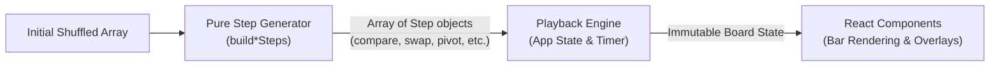

# algorithm-visualizer

An interactive web application that visualizes and compares sorting algorithms side by side in real time.

All algorithms sort the same shuffled dataset at the same playback speed, so you can see how they differ in strategy, comparisons, and data movement.

## Key Features

- Bubble sort, selection sort, merge sort, and quick sort each run in their own panel. Each bar is labeled with its value.
- The merge sort panel shows the values remaining on each side, the value just moved to the result, and the result as it is built.
- Use the chips above the playback controls to choose which algorithms to show, and drag the handle beside each chip to reorder the panels. Keyboard users can press Space, move with arrow keys, and press Space to drop or Escape to cancel. Hidden algorithms keep their playback state.
- Play, pause, and shuffle, and set the number of bars (5–50) and the animation speed (0.2×–10×).
- Japanese and English UI (chosen from the browser language, with a manual switch), light and dark modes, and a layout that adapts to the screen width.

## Architecture & How It Works

Sorting and playback are separated:



1. Each algorithm has a pure function in `src/plugins/visualizer.ts` that sorts a copy of the input and records the whole process as an array of `Step` objects (compare, swap, write, and so on).
2. `src/App.tsx` applies one step to each board per tick of the animation timer, without re-running the sort.

## Tech Stack

- **Framework**: React 19, TypeScript
- **UI & Styling**: Mantine UI, Vanilla CSS
- **Bundler & Tooling**: Parcel, Vitest, Testing Library, ESLint, Prettier

`yarn typecheck` runs TypeScript 7 (`tsc`, installed as `@typescript/native`). The `typescript` package is an alias of `@typescript/typescript6`, which provides the TypeScript 6 API that typescript-eslint needs, because TypeScript 7 does not ship an API yet. This follows [Running side-by-side with TypeScript 6.0](https://devblogs.microsoft.com/typescript/announcing-typescript-7-0/#running-side-by-side-with-typescript-60).

## Development Setup

The project is configured to run inside Docker. Node.js on the host is needed only for the pre-commit hook when it runs there (see [Pre-commit Hook](#pre-commit-hook)), and optionally for type resolution in an editor running on the host.

The Node.js version is set in `.nvmrc`. CI and the production build on Render read it, and the Docker image uses the same major version. Update them together.

### Using Docker Compose

```bash
# Start dev server with hot reload
docker compose up -d --build
```

The application is served at:
- **Japanese**: http://localhost:1234/ja/
- **English**: http://localhost:1234/en/

Each checkout, including each git worktree, runs as its own Compose project with its own container. They all publish host port 1234 by default, though, so only one dev server can use it at a time. To run another checkout's server alongside, pick a different host port with `DEV_PORT`:

```bash
DEV_PORT=1235 docker compose up -d --build
```

That server is then at http://localhost:1235/ja/ and http://localhost:1235/en/. Pass the same `DEV_PORT` whenever you run `docker compose up` again in that checkout; `docker compose exec` does not need it.

### Using Dev Containers

If your editor supports VS Code Dev Containers:
1. Open this repository in your container-supported editor.
2. Select **Reopen in Container**. Dependencies will be installed automatically.

## Quality Checks & Commands

Run commands inside the running container:

```bash
# Execute tests
docker compose exec -T app bash -c 'yarn test'

# Type check, lint, format check, and test in one go
docker compose exec -T app bash -c 'yarn typecheck && yarn lint && yarn format && yarn test'
```

| Command | Description |
|---|---|
| `yarn dev` | Starts Parcel dev server |
| `yarn build` | Builds the production bundle into `public/`, with asset URLs pointing to the production site so Open Graph images are absolute |
| `yarn typecheck` | Validates TypeScript types (`tsc --noEmit`) |
| `yarn lint` / `yarn lint:fix` | Runs ESLint / applies auto-fixes |
| `yarn format` / `yarn format:fix` | Checks / applies Prettier formatting |
| `yarn test` | Runs Vitest unit and UI test suite |

### Pre-commit Hook

A Husky pre-commit hook runs `lint-staged` on staged files. It runs inside the `app` container when that service is running, and on the host otherwise.

In a git worktree, the container mounts only the worktree, so the shared `.git` directory is not visible inside it. The hook therefore always runs on the host there, which requires host dependencies. Install them with the Node.js version from `.nvmrc` (for example, after `nvm use`):

```bash
COREPACK_ENABLE_AUTO_PIN=0 yarn install --frozen-lockfile
```

For the same reason, Husky's `prepare` script prints a git error during the container's install in a worktree. The error is harmless and does not stop the install.

## Project Structure

```text
src/
├── App.tsx                    # Main layout, playback loop, and board states
├── plugins/                   # Step types and step generators (visualizer.ts), i18n setup (i18n.ts)
├── components/                # Shared UI controls, bars, and per-algorithm overlays
│   ├── ControlBar.tsx
│   ├── SortSection.tsx
│   └── algorithms/            # Visual representations & legends for each algorithm
├── ja/, en/                   # Localized HTML templates and dictionary strings
└── __tests__/                 # Logic tests and UI component specifications
```
